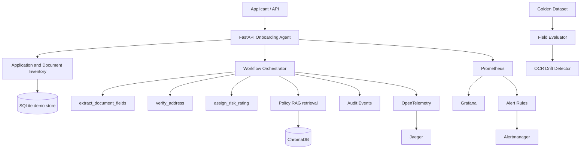

# Onboarding Accelerator — Account-Opening & KYC Agent

Runnable training capstone reference implementation. It consolidates the applicant journey, maintains a document inventory, runs the three required tools (`extract_document_fields`, `verify_address`, `assign_risk_rating`), retrieves policy guidance through RAG, records auditable events and exposes observability for the business SLO.

> **Synthetic training data only.** This is not a production bank onboarding, AML, identity-authenticity or account-approval system. Human review is mandatory. Never use real customer KYC documents in this demo.

## Business capabilities

- One application record per `applicant_id`.
- Document intake and inventory with received/verified/needs-review state.
- Field extraction, required-field checks and expiry checks.
- Address comparison against the application address.
- Transparent preliminary risk triage.
- Policy retrieval using chunked documents and persistent ChromaDB.
- Duplicate document-request guard: block requests for a document already received or verified.
- Request history and chronological audit events.
- Field-level golden-dataset evaluation and simulated OCR vendor regression.
- OpenTelemetry, Jaeger, Prometheus, Grafana and Alertmanager.
- Business SLO: applications reaching a preliminary decision without a duplicate request for an already received/verified document.

## Architecture



**Keep the stores separate:** ChromaDB stores policy/reference chunks; SQLite stores applicant state, submitted-document inventory, requests and audit events; `data/ground_truth.json` is only the labelled evaluation set.

## API endpoints

Swagger: `http://localhost:8000/docs`

| Method | Endpoint | Purpose |
|---|---|---|
| GET | `/health` | Health check |
| POST | `/applications` | Create applicant application |
| GET | `/applications/{id}` | Application and latest assessment |
| POST | `/applications/{id}/documents` | Register submitted document text |
| GET | `/applications/{id}/documents` | List document inventory (without document text) |
| POST | `/applications/{id}/process` | Process all documents in inventory |
| POST | `/applications/{id}/document-requests` | Request missing/replacement document; duplicate guard applies |
| GET | `/applications/{id}/document-requests` | Request history |
| GET | `/applications/{id}/audit` | Audit events |
| GET | `/slo/summary` | Business SLO summary |
| GET | `/knowledge/search` | Search policy chunks |
| POST | `/evaluation/run` | Field-level evaluation |
| POST | `/demo/ocr-degradation` | Simulate silent DOB extraction regression |
| GET | `/drift/status` | Drift state |
| GET | `/metrics` | Prometheus metrics |

## Docker quick start (recommended)

PowerShell:
```powershell
Copy-Item .env.example .env
```
Edit `.env` and set `OPENAI_API_KEY` to enable automatic policy embedding/indexing. `LLM_PROVIDER=mock` remains the default, so the KYC field extractor uses the deterministic labelled-text parser. Set `LLM_PROVIDER=openai` only if you also want model-based text extraction.

Start everything:
```powershell
docker compose up --build
```
Compose starts a one-shot `rag-ingest` service before the API. With an API key it loads, redacts, chunks, embeds and stores policy docs in the shared `chroma-data` volume. With no key it prints a skip message and the mock workflow still starts.

After adding/changing policy documents:
```powershell
docker compose run --rm rag-ingest
```

Service URLs: API/Swagger `:8000/docs`, Prometheus `:9090`, Grafana `:3000` (`admin` / `.env` password), Jaeger `:16686`, Alertmanager `:9093`.

## PowerShell demo walkthrough

### 1. Create application
```powershell
$body = @{ applicant_id="demo-001"; full_name="Asha Rao"; email="asha@example.test"; application_address="12 Sample Road, Hyderabad, Telangana, 500001" } | ConvertTo-Json
Invoke-RestMethod -Uri "http://localhost:8000/applications" -Method Post -ContentType "application/json" -Body $body
```

### 2. Submit passport
```powershell
$body = @{ document_type="passport"; vendor_version="ocr-v1"; source_filename="synthetic-passport.txt"; document_text="Name: Asha Rao`nDate of Birth: 1990-06-15`nDocument Number: P1234567`nExpiry Date: 2030-06-15`nAddress: 12 Sample Road, Hyderabad, Telangana, 500001" } | ConvertTo-Json
Invoke-RestMethod -Uri "http://localhost:8000/applications/demo-001/documents" -Method Post -ContentType "application/json" -Body $body
```

### 3. Submit proof of address (optional)
```powershell
$body = @{ document_type="proof_of_address"; vendor_version="ocr-v1"; document_text="Name: Asha Rao`nAddress: 12 Sample Road, Hyderabad, Telangana, 500001`nStatement Date: 2026-10-01" } | ConvertTo-Json
Invoke-RestMethod -Uri "http://localhost:8000/applications/demo-001/documents" -Method Post -ContentType "application/json" -Body $body
```

### 4. Process all submitted documents
```powershell
Invoke-RestMethod -Uri "http://localhost:8000/applications/demo-001/process" -Method Post -ContentType "application/json" -Body "{}"
```

### 5. Inspect inventory and audit
```powershell
Invoke-RestMethod "http://localhost:8000/applications/demo-001/documents"
Invoke-RestMethod "http://localhost:8000/applications/demo-001/audit"
Invoke-RestMethod "http://localhost:8000/applications/demo-001"
```

### 6. Demonstrate duplicate-request prevention
```powershell
$body = @{ document_type="passport"; reason="Passport copy required" } | ConvertTo-Json
Invoke-RestMethod -Uri "http://localhost:8000/applications/demo-001/document-requests" -Method Post -ContentType "application/json" -Body $body
```
Expected: `sent_to_customer = false`, status `BLOCKED_DUPLICATE`. A replacement request can be sent if the earlier document is marked `NEEDS_REVIEW`.

### 7. Show the business SLO
```powershell
Invoke-RestMethod "http://localhost:8000/slo/summary"
```
The denominator is applications with a recorded preliminary decision. The numerator excludes decisions associated with an actual duplicate request sent for a document already received/verified. Blocked attempts are separately audited and do not count as customer re-requests. The 95% target is illustrative and must be agreed with the business.

### 8. Evaluation and OCR regression demo
```powershell
Invoke-RestMethod -Uri "http://localhost:8000/evaluation/run" -Method Post -ContentType "application/json" -Body "{}"
Invoke-RestMethod -Uri "http://localhost:8000/demo/ocr-degradation" -Method Post
Invoke-RestMethod "http://localhost:8000/drift/status"
```

## RAG pipeline

Place synthetic policy/reference files in `documents/` (`pdf`, `docx`, `html`, `csv`, `json`, `txt`, `md`). Pipeline: loaders → PII pattern redaction → logical text units → paragraph/sentence-aware overlap chunking → OpenAI embeddings → ChromaDB `kyc_policy_knowledge` → top-K retrieval.

Defaults: 1,000-character chunks and 150-character overlap. Search at `/knowledge/search?q=passport%20requirements&top_k=4`. The Docker named volume `chroma-data` is mounted at `/app/chroma_store`; it is not a normal host folder.

## Important boundaries / known limitations

- The API demo accepts synthetic text, not scanned customer image/PDF uploads. PDF loading is for policy/reference ingestion. The OpenAI adapter is text extraction, not OCR.
- No document authenticity, sanctions, PEP, fraud or official identity-database verification is implemented.
- Address comparison is normalized exact-string matching, not proof of identity or residency.
- Risk bands are transparent demo rules, not a validated bank risk model.
- The duplicate guard blocks requests when a same-type document is `RECEIVED` or `VERIFIED`; a replacement request can be made after `NEEDS_REVIEW`.
- SQLite, regex PII handling and audit storage are demo-only. Production needs encrypted managed storage, RBAC, immutable audit, retention controls, malware scanning, authentication, authorization, durable queues and an approved human-review process.
- `READY_FOR_REVIEW` is not account approval. A trained reviewer and approved identity checks remain necessary.
- OCR drift simulation deliberately corrupts labelled DOB output; it is not a live vendor integration.

## Tests

```powershell
pip install -r requirements.txt
$env:PYTHONPATH="src"
pytest -q
```
